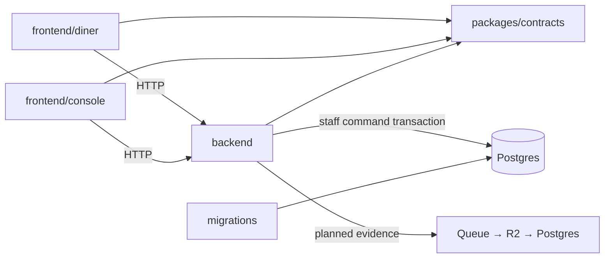

# Architecture

Baseline: [PeekaPlate Orchestration + V1 Team Plan](https://claude.ai/artifact/HxpC9aET7geEwkEpyG6wrt), reviewed October 13, 2026. **3D is the hook. The loop is the product.** Accepted decisions are indexed in [ADRs](adr/README.md); implementation progress is explicit in [delivery](delivery.md).

## Module boundaries

One repository, separate build targets. The diner is static TypeScript/Vite; the staff console is React/Vite. Hono runs the API on Workers. Shared contracts contain serializable schemas, not database clients, UI or Three.js objects. SQL migrations own database changes. Add backend modules `content`, `publication`, `intent`, `orders`, `experiments` only as each feature arrives; a future-folder forest adds no value.

## Two kinds of events

**Domain events** are accepted business facts. Dish revisions, approvals, publication, availability and experiments are selective event-sourced streams in Postgres. A command checks authority and expected version, then atomically appends facts, updates live projections, records the command result and queues outbox work. Replay rebuilds projections without external side effects.

**Intent observations** record what the diner app observed. The planned flow is phone outbox → ingest Worker → Queue receipt → create-only R2 archive → deduplicated Postgres rows → queue acknowledgement. No receipt before Queue acceptance; delete only acknowledged event IDs locally. These observations rebuild metrics, not business state.

The exposure contract pins the publication, dish revision, actual tier, renderer/manifest version, availability version and experiment assignment. A server-side temporal query describes the committed menu state. It cannot prove a cached/offline client displayed that state; use its pinned exposure record.

## Visuals and analysis

T0 is a complete photo/text menu. T1 is shallow parallax using reviewed cutouts. T2 separates captured plating stages with limited viewpoints and a fallback. Three.js is loaded only after a tap behind `mount / update / dispose`; T3/AR is deferred. Size references must come from measured captures.

A redeem code links a browsing session to a POS ticket, not to an individual's thoughts. Unlinked means unknown. Initial readouts show sample units, linkage coverage, suppressed small cells and directional uncertainty. Owner changes are tested with a frozen blocked-switchback plan.

## Implemented boundary

Internal staging analytics has a separate read boundary under [ADR 0014](adr/0014-team-analytics-access.md). GitHub-authenticated teammates must be current repository collaborators; the Worker invokes a bounded security-definer read function owned by a non-login role. Its allowlisted responses omit visitor identities and arbitrary properties. Runtime and public roles cannot read the raw analytics tables or change project scope. The endpoints are absent outside local/staging configuration; hosted activation is tracked separately in [team data access](team-data-access.md).

Current code has shells, health and dish-revision contracts, signed JWT verification and a staff-authorized write API. The command locks current membership, assigns transaction-local actor/venue context and serializes command identity and dish versions. Its event, live projection, receipt and pending outbox row commit together. A pure reducer reconstructs the dish projection; it never dispatches outbox work.

PostgreSQL provides a restricted runtime group role. Membership's narrowly granted update privilege exists only to permit a share lock; its update policy denies every mutation. Runtime credentials remain server-only. JWT verification proves signed claims; active restaurant permission is checked in the database on every command, including retries. Provider session revocation behavior remains part of the real Supabase integration checkpoint.

Local integration uses synthetic signed tokens, real PostgreSQL and workerd. It does not establish hosted Supabase/Hyperdrive compatibility, cloud latency or recovery. Queue/R2 ingestion, publication and the staff login UI remain planned. [PR sequencing](delivery.md) supplies subsequent slices.
