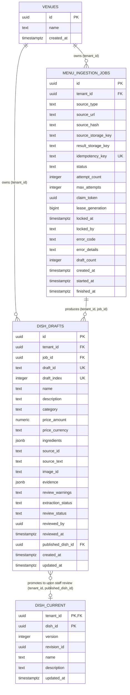

# S3-VIS-01: Menu Ingestion Persistence Architecture & Migration Proposal

Status: Architecture Proposal (Four-Issue Review & Implementation Verification) · 2026-10-26 · Owner: Teeyansh (S3-VIS-01 DRI) · Reviewers: Jeffin (Database Architecture), Sai (Infrastructure/Validation), Vivien (Product Architecture)

---

## 1. Executive Summary

This document establishes the persistence architecture for **S3-VIS-01: Menu Ingestion Orchestration Layer**. It introduces two private database models in the PostgreSQL `app_private` schema:
1. `app_private.menu_ingestion_jobs`: Coordinates the lifecycle of asynchronous menu ingestion jobs across URL, PDF, photo, and text sources. Manages tenant scoping, source provenance, cryptographic worker lease fencing, atomic state transitions, retry attempts, and structured diagnostics.
2. `app_private.dish_drafts`: Stores unreviewed extracted dish drafts produced by the Python OCR/LLM extraction pipeline. Every draft is strictly isolated from active published dishes (`app_private.dish_current`), maintains exact source evidence spans and segment hashes, preserves decimal prices without floating-point conversion, and remains in the mandatory `needs_review` state until explicit human review.

This document specifically resolves four implementation-blocking architecture issues:
1. **Composite Foreign Key Deletion Semantics:** Resolves referencing behavior from `dish_drafts(tenant_id, published_dish_id)` to `dish_current(tenant_id, dish_id)` under `tenant_id NOT NULL`.
2. **Watertight Worker Lease Fencing:** Eliminates stale-worker race conditions via a per-claim cryptographic `claim_token` and `lease_generation`, enforced through `SELECT ... FOR UPDATE` row locks within a single transaction boundary.
3. **Safe Retry Upsert Behavior:** Refines draft upsert conflict handling so that retries update extraction fields on pending drafts while strictly preserving human reviews, staff edits, and approval timestamps.
4. **Database Test Framework Verification:** Verifies the repository's native pgTAP and Vitest test framework in `scripts/test-db.mjs` and specifies executable test scenarios for all edge cases.

> [!IMPORTANT]
> **Safety Boundary:** This is an architectural proposal and test specification document. No active migrations have been placed in `migrations/`, no migrations have been executed, and no shared or staging database instances have been modified.

---

## PART I: Verified Repository Facts

The following facts have been verified directly against the PeekaPlate codebase:

### 1. Database Engine & Migration Framework
- **Migration Framework:** `dbmate` (`ghcr.io/amacneil/dbmate:2.36.0`).
- **Migration Directory:** `migrations/`. Files follow timestamp naming (e.g., `202610130001_foundation.sql`).
- **Database Engine:** PostgreSQL 16.11 (`postgres:16.11-bookworm` in `tests/db/Dockerfile`).
- **Schema Boundary:** All private operational tables live in `app_private`. Direct access is revoked from `PUBLIC`.
- **Immutable Forward-Only Migrations:** In accordance with repository invariant (AGENTS.md), applied migrations are immutable. Every migration intentionally raises an exception in `-- migrate:down`. All schema evolution is forward-only.

### 2. Roles, Privileges, and Forced RLS
- **Superuser (`postgres`):** Used exclusively by dbmate for schema migrations and by test fixtures.
- **Application Runtime (`peekaplate_runtime`):** Non-login, no-inherit role (`NOLOGIN NOINHERIT`). Lacks `BYPASSRLS`. Application connections operate under this role.
- **Forced Row Level Security:** Every table in `app_private` enforces `ENABLE ROW LEVEL SECURITY` and `FORCE ROW LEVEL SECURITY`. Table owners cannot bypass RLS. Policies evaluate `current_setting('app.tenant_id', true)::uuid`.
- **Privilege Grants:** Tables in `app_private` grant `SELECT, INSERT, UPDATE` to `peekaplate_runtime`. **`DELETE` is explicitly withheld.** Deletions are forbidden in normal application workflows.

### 3. Tenant = Venue Semantics
- **Boundary Verification:** `migrations/202610130001_foundation.sql` defines `app_private.venues (id uuid PRIMARY KEY)`. There is no separate multi-venue "tenant" entity. In PeekaPlate, **the venue IS the tenant boundary**.
- **Foreign Key Naming:** Child tables (`es_event`, `es_command`, `staff_membership`, `dish_current`) name the foreign key column `tenant_id`:
  `tenant_id uuid NOT NULL REFERENCES app_private.venues(id) ON DELETE RESTRICT`.
- **Context Establishment:**
  - Authenticated staff requests: JWT verified, `staff_membership` validated under `FOR SHARE` lock, and `app.tenant_id` set transaction-locally.
  - Background workers: Cloudflare Queue messages carry signed `{ tenant_id, job_id }`. The worker executes `SELECT set_config('app.tenant_id', $1, true)`. The `true` parameter enforces transaction-local scoping (`SET LOCAL`), automatically clearing context on commit or rollback and preventing connection-pool leakage.

### 4. Price Representation & Precision
- **Producer Pipeline:** `processing/src/peekaplate_processing/schemas.py` defines `price_amount: Decimal | None`. Python `Decimal` is an arbitrary-precision base-10 number.
- **Adapter Pipeline:** `backend/src/ingestion/adapter.ts` strips commas and normalizes the price into an exact decimal string matching `/^\d+(\.\d+)?$/` without floating-point conversion.
- **Zero Price Handling:** `$0.00` is a valid price, distinct from `null` (unknown price).
- **PostgreSQL Column Type:** Unconstrained `numeric` (`CHECK (price_amount IS NULL OR price_amount >= 0)`) stores exact base-10 representations without precision loss or rounding.

### 5. Database Test Infrastructure
- **Harness:** `scripts/test-db.mjs` orchestrates a disposable Docker container running `peekaplate-postgres-pgtap:16.11`.
- **pgTAP Configuration:** Built from `tests/db/Dockerfile` with `postgresql-16-pgtap` installed.
- **Execution Flow in `test:db`:**
  1. Starts disposable PostgreSQL container with dbmate forward migrations.
  2. Executes all pgTAP suites in `tests/db/*.sql` via `psql` and validates TAP output via `validateTap()`.
  3. Executes Vitest database integration tests via `vitest run --config vitest.db.config.ts` (passing `PEEKAPLATE_DB_TEST_URL` and `PEEKAPLATE_DB_ADMIN_URL`).
  4. Runs smoke check `backend/local.mjs check`.
- **Existing Suites:** `foundation.sql`, `staff.sql`, `posthog.sql`, `team-analytics.sql`, and `backend/src/dish.integration.ts`.

---

## PART II: Architectural Design & Issue Resolutions



---

### Issue 1: Composite Foreign Key Deletion Behavior

#### 1. The `tenant_id NOT NULL` Conflict in Standard SQL
`dish_drafts` links to `dish_current` via composite key `(tenant_id, published_dish_id)` matching `dish_current(tenant_id, dish_id)`.
Under standard SQL, a generic `ON DELETE SET NULL` attempts to set **both** columns of the foreign key to `NULL`. Because `dish_drafts.tenant_id` is defined as `NOT NULL`, deleting a row in `dish_current` causes a runtime constraint violation:
```
ERROR: null value in column "tenant_id" of relation "dish_drafts" violates not-null constraint
```

#### 2. Verified Resolution in PostgreSQL 16
PostgreSQL 15 and 16 natively support **column-specific** `SET NULL` syntax:
```sql
FOREIGN KEY (tenant_id, published_dish_id)
  REFERENCES app_private.dish_current(tenant_id, dish_id)
  ON DELETE SET NULL (published_dish_id)
```
Under this definition:
- When a referenced row in `dish_current` is deleted, PostgreSQL sets **only** `published_dish_id` to `NULL`.
- `dish_drafts.tenant_id` is untouched and remains `NOT NULL`.
- The draft check constraint `CHECK (published_dish_id IS NULL OR review_status IN ('accepted', 'edited'))` evaluates to `true` (since `NULL IS NULL`).
- The draft retains its full source evidence, review history, and staff metadata.

#### 3. Alignment with the Event-Sourced Publication Model
In PeekaPlate's event-sourced architecture (`backend/src/dish-command.ts`):
- `dish_current` is an active read projection populated from `es_event`.
- The application role `peekaplate_runtime` is granted `SELECT, INSERT, UPDATE` on `dish_current`; `DELETE` is not granted.
- Published dishes are never deleted by application workflows; deactivations occur via event commands producing inactive revisions.
- Two viable deletion policies exist:
  1. **Policy A (Primary Recommendation): `ON DELETE SET NULL (published_dish_id)`**:
     If an administrative maintenance operation or test cleanup deletes a row from `dish_current`, the draft safely unlinks without corrupting tenancy or throwing an error.
  2. **Policy B (Alternative): `ON DELETE RESTRICT`**:
     Prevents deleting any row in `dish_current` that has an accepted draft referencing it. This strictly enforces immutability and provenance tracking.
- **Recommendation:** Adopt **Policy A (`ON DELETE SET NULL (published_dish_id)`)** in the proposed migration because it is fully supported by PostgreSQL 16.11 and handles administrative operations cleanly.

---

### Issue 2: Watertight Worker Lease Fencing & Concurrency Control

#### 1. Vulnerability of Reusable Worker Identifiers
If a job lease is protected only by worker name/ID (e.g. `locked_by = 'worker-1'`), retry attempts can produce catastrophic concurrency races. If Worker A (ID `worker-1`) experiences an execution pause (GC, CPU throttle, R2 delay), its 10-minute lease expires. Worker B (or another attempt by `worker-1`) reclaims the job. When delayed Worker A resumes, matching `locked_by` allows it to overwrite drafts or finalize the job out of turn.

#### 2. Per-Claim Fencing Mechanism
To guarantee mutual exclusion across worker attempts, `app_private.menu_ingestion_jobs` includes two fencing columns:
- `claim_token uuid`: A cryptographically unique UUID (`gen_random_uuid()`) generated freshly on **every** claim grant.
- `lease_generation bigint NOT NULL DEFAULT 0`: A monotonically increasing 64-bit integer incremented on every claim.

#### 3. Step-by-Step Enforced Operations

##### Step 1: Atomic Job Claim
```sql
UPDATE app_private.menu_ingestion_jobs
SET status = 'running',
    claim_token = gen_random_uuid(),
    lease_generation = lease_generation + 1,
    locked_at = now(),
    locked_by = $1,
    attempt_count = attempt_count + 1,
    started_at = COALESCE(started_at, now())
WHERE id = $2 AND tenant_id = $3
  AND (
    status = 'queued'
    OR (status = 'running' AND locked_at < now() - interval '10 minutes')
    OR (status = 'incomplete' AND attempt_count < max_attempts)
  )
RETURNING claim_token, lease_generation;
```
If `rowCount === 0`, the job is locked or in a terminal state. If `rowCount === 1`, the worker receives a unique `claim_token`.

##### Step 2: Elimination of TOCTOU Races via Row Locks
When Python extraction finishes, draft persistence begins inside a single database transaction:
```sql
BEGIN;
SELECT set_config('app.tenant_id', $tenant_id, true);

-- 1. Validate Fencing Token, Lease Freshness, and Acquire Exclusive Row Lock
SELECT lease_generation
FROM app_private.menu_ingestion_jobs
WHERE id = $job_id AND tenant_id = $tenant_id
  AND status = 'running'
  AND claim_token = $claim_token
  AND locked_at >= now() - interval '10 minutes'
FOR UPDATE;
```
- **If `rowCount === 0`:** The claim is invalid because:
  - It was reclaimed by another worker attempt (which replaced `claim_token`), OR
  - Its 10-minute lease **expired** (even if no other worker has claimed it yet).
  In either case, the stale worker issues `ROLLBACK;` and drops out. **Zero drafts are written.**
- **If `rowCount === 1`:** The worker holds an active, unexpired lease and holds an exclusive `FOR UPDATE` lock on the job row. Because `UPDATE menu_ingestion_jobs` requires a row-level lock, no other worker can reclaim the job while this transaction is open, eliminating time-of-check/time-of-use races.

##### Step 3: Transactional Draft Persistence & Completion
Within the same transaction holding the row lock:
1. Drafts are batch-upserted into `app_private.dish_drafts`.
2. Job completion updates the status, validates lease freshness again, and invalidates the token:
```sql
UPDATE app_private.menu_ingestion_jobs
SET status = 'complete',
    draft_count = $draft_count,
    finished_at = now(),
    locked_at = NULL,
    locked_by = NULL,
    claim_token = NULL
WHERE id = $job_id AND tenant_id = $tenant_id
  AND status = 'running'
  AND claim_token = $claim_token
  AND locked_at >= now() - interval '10 minutes';

COMMIT;
```
Because validation, lease freshness checking, draft writes, and job completion occur in a **single transaction holding an exclusive row lock**, expired or stale workers cannot commit writes.

---

### Issue 3: Retry Upsert & Draft Conflict Behavior

#### 1. The Problem with Naive Conflict Handling
A naive upsert clause such as:
`ON CONFLICT (tenant_id, job_id, draft_index) DO UPDATE SET updated_at = now() WHERE review_status = 'pending'`
is dangerously defective: it only updates `updated_at`, silently retaining obsolete extraction fields when a retry produces corrected data.

#### 2. Explicit Conflict Policy
Draft insertion on retry executes:
```sql
INSERT INTO app_private.dish_drafts
  (id, tenant_id, job_id, draft_id, draft_index, name, description, category,
   price_amount, price_currency, ingredients, source_id, source_text, image_id,
   evidence, review_warnings, extraction_status, review_status)
VALUES ($1, $2, $3, $4, $5, $6, $7, $8, $9, $10, $11, $12, $13, $14, $15, $16, 'needs_review', 'pending')
ON CONFLICT (tenant_id, job_id, draft_index) DO UPDATE
SET draft_id = EXCLUDED.draft_id,
    name = EXCLUDED.name,
    description = EXCLUDED.description,
    category = EXCLUDED.category,
    price_amount = EXCLUDED.price_amount,
    price_currency = EXCLUDED.price_currency,
    ingredients = EXCLUDED.ingredients,
    source_id = EXCLUDED.source_id,
    source_text = EXCLUDED.source_text,
    image_id = EXCLUDED.image_id,
    evidence = EXCLUDED.evidence,
    review_warnings = EXCLUDED.review_warnings,
    updated_at = now()
WHERE app_private.dish_drafts.review_status = 'pending';
```

#### 3. State-by-State Behavior Matrix

| Draft State | Retry Action | Result & Invariant Enforced |
| :--- | :--- | :--- |
| **`pending`** | Overwrite with `EXCLUDED.*` | **Updated with corrected extraction fields.** Never retains obsolete data. Primary key `id` is preserved. |
| **`accepted`** | Conflict predicate evaluates false | **Protected.** Review decision, staff actor (`reviewed_by`), timestamp, and `published_dish_id` are strictly preserved. |
| **`edited`** | Conflict predicate evaluates false | **Protected.** Manual staff corrections (name, description, price) are never overwritten by AI retries. |
| **`rejected`** | Conflict predicate evaluates false | **Protected.** Staff rejection decision is permanently preserved. |
| **Stale Attempt** | Fencing check blocks transaction | **Blocked.** Stale worker cannot acquire `FOR UPDATE` lock or commit writes. |

#### 4. Handling Surplus Drafts on Retries
If attempt 1 persisted 5 drafts before failing, and retry attempt 2 produces only 3 drafts:
- Drafts 0, 1, 2 are updated via the upsert.
- For surplus drafts (index >= 3) that remain `pending`, because `DELETE` is withheld from `peekaplate_runtime`, the completion transaction marks them `superseded` (not human-rejected):
```sql
UPDATE app_private.dish_drafts
SET review_warnings = array_append(review_warnings, 'superseded_by_retry'),
    review_status = 'superseded',
    updated_at = now()
WHERE tenant_id = $tenant_id AND job_id = $job_id
  AND draft_index >= $new_draft_count AND review_status = 'pending';
```
This preserves an immutable audit trail without requiring `DELETE` privileges, without fabricating a human rejection (`reviewed_by` remains `NULL`), and adhering strictly to domain semantics.

#### 5. Retrying Same Job vs Ingesting Changed Source
- **Retrying Same Job:** Targets the same `job_id`. Handled by the conflict clause above.
- **Ingesting Changed Source:** Submitting a modified menu document generates a distinct `idempotency_key` (derived from client request ID or source SHA-256), creating a new row in `menu_ingestion_jobs` with a unique `id` (`job_id_2`). All drafts for `job_id_2` have `job_id = job_id_2` and do not conflict with `job_id_1`. Both jobs and their drafts coexist independently.

---

### Issue 4: Database Test Framework Verification

#### 1. Verification of the Repository Test Harness
Inspection of `package.json`, `tests/db/Dockerfile`, and `scripts/test-db.mjs` confirms:
1. `pnpm test:db` executes `node scripts/test-db.mjs`.
2. Docker builds `peekaplate-postgres-pgtap:16.11` from `postgres:16.11-bookworm` with `postgresql-16-pgtap` installed.
3. `scripts/test-db.mjs` mounts `tests/db` to `/tests`, applies all migrations via dbmate, runs every `tests/db/*.sql` file with `psql`, and validates TAP output using `validateTap()`.
4. Then `scripts/test-db.mjs` runs Vitest integration tests in `backend/src/**/*.integration.ts` via `vitest.db.config.ts`.
5. **Conclusion:** pgTAP and Vitest database testing are already fully installed, configured, and operational in the repository.

#### 2. Executable Test Specifications

##### Tier 1: pgTAP Schema, Privilege, & Constraint Suite (`tests/db/menu_ingestion.sql`)
The specification in Section 10.1 tests:
1. Table existence and forced RLS on both tables.
2. Runtime role privileges (`SELECT, INSERT, UPDATE` granted; `DELETE` denied).
3. Fail-closed tenant isolation without `app.tenant_id`.
4. Tenant isolation for own venue.
5. Cross-tenant read and write rejection (Venue B cannot see or modify Venue A data).
6. Cross-tenant foreign key rejection.
7. Exact decimal price preservation (`0.00` zero price and arbitrary precision).
8. Extraction and review status CHECK constraints.
9. Composite FK deletion behavior (`ON DELETE SET NULL (published_dish_id)` leaves `tenant_id` intact).

##### Tier 2: Vitest Concurrency & Retry Suite (`backend/src/ingestion/ingestion.integration.ts`)
The specification in Section 10.2 tests:
1. Fencing token generation on job claim.
2. Monotonic increment of `lease_generation`.
3. Worker lease expiration and reclamation by Worker 2.
4. Immediate rejection of stale Worker 1 writes after lease reclamation.
5. Safe retry upsert updating pending drafts.
6. Safe retry upsert preserving accepted and edited drafts.
7. Surplus draft superseding.

---

## PART III: SQL Migration Proposal

*(Proposal only — to be placed in `migrations/<timestamp>_menu_ingestion_drafts.sql` upon sign-off)*

```sql
-- migrate:up

-- 1. Menu Ingestion Job Lifecycle Table
CREATE TABLE app_private.menu_ingestion_jobs (
  id uuid PRIMARY KEY,
  tenant_id uuid NOT NULL REFERENCES app_private.venues(id) ON DELETE RESTRICT,
  source_type text NOT NULL CHECK (source_type IN ('url', 'pdf', 'photo', 'text')),
  source_url text CHECK (source_url IS NULL OR length(btrim(source_url)) > 0),
  source_hash text CHECK (source_hash IS NULL OR source_hash ~ '^[0-9a-f]{64}$'),
  source_storage_key text CHECK (source_storage_key IS NULL OR length(btrim(source_storage_key)) > 0),
  result_storage_key text CHECK (result_storage_key IS NULL OR length(btrim(result_storage_key)) > 0),
  idempotency_key text NOT NULL CHECK (length(btrim(idempotency_key)) > 0),
  status text NOT NULL DEFAULT 'queued' CHECK (status IN ('queued', 'running', 'complete', 'incomplete', 'failed')),
  attempt_count integer NOT NULL DEFAULT 0 CHECK (attempt_count >= 0),
  max_attempts integer NOT NULL DEFAULT 3 CHECK (max_attempts > 0),
  claim_token uuid,
  lease_generation bigint NOT NULL DEFAULT 0 CHECK (lease_generation >= 0),
  locked_at timestamptz,
  locked_by text CHECK (locked_by IS NULL OR length(btrim(locked_by)) > 0),
  error_code text CHECK (error_code IS NULL OR length(btrim(error_code)) > 0),
  error_details text CHECK (error_details IS NULL OR length(btrim(error_details)) > 0),
  draft_count integer NOT NULL DEFAULT 0 CHECK (draft_count >= 0),
  created_at timestamptz NOT NULL DEFAULT now(),
  started_at timestamptz,
  finished_at timestamptz,
  UNIQUE (tenant_id, idempotency_key),
  UNIQUE (tenant_id, id),
  CHECK (started_at IS NULL OR started_at >= created_at),
  CHECK (finished_at IS NULL OR started_at IS NULL OR finished_at >= started_at),
  CHECK (status != 'running' OR started_at IS NOT NULL),
  CHECK (status NOT IN ('complete', 'incomplete', 'failed') OR finished_at IS NOT NULL),
  CHECK (status != 'running' OR claim_token IS NOT NULL)
);

CREATE INDEX menu_ingestion_jobs_tenant_status_idx
  ON app_private.menu_ingestion_jobs (tenant_id, status, created_at DESC);

CREATE INDEX menu_ingestion_jobs_recovery_idx
  ON app_private.menu_ingestion_jobs (status, locked_at)
  WHERE status = 'running';

-- 2. Dish Drafts Table (Unreviewed AI/OCR Extractions)
CREATE TABLE app_private.dish_drafts (
  id uuid PRIMARY KEY,
  tenant_id uuid NOT NULL REFERENCES app_private.venues(id) ON DELETE RESTRICT,
  job_id uuid NOT NULL,
  draft_id text NOT NULL CHECK (length(btrim(draft_id)) > 0),
  draft_index integer NOT NULL CHECK (draft_index >= 0),
  name text NOT NULL CHECK (length(btrim(name)) > 0 AND length(name) <= 160),
  description text CHECK (description IS NULL OR length(description) <= 4000),
  category text CHECK (category IS NULL OR length(btrim(category)) > 0),
  price_amount numeric CHECK (price_amount IS NULL OR price_amount >= 0),
  price_currency text CHECK (price_currency IS NULL OR price_currency ~ '^[A-Z]{3}$'),
  ingredients jsonb CHECK (ingredients IS NULL OR jsonb_typeof(ingredients) = 'array'),
  source_id text NOT NULL CHECK (length(btrim(source_id)) > 0),
  source_text text NOT NULL CHECK (length(btrim(source_text)) > 0),
  image_id text CHECK (image_id IS NULL OR length(btrim(image_id)) > 0),
  evidence jsonb NOT NULL CHECK (jsonb_typeof(evidence) = 'object'),
  review_warnings text[] NOT NULL DEFAULT '{}'::text[],
  extraction_status text NOT NULL DEFAULT 'needs_review' CHECK (extraction_status = 'needs_review'),
  review_status text NOT NULL DEFAULT 'pending' CHECK (review_status IN ('pending', 'accepted', 'rejected', 'edited', 'superseded')),
  reviewed_by uuid,
  reviewed_at timestamptz,
  published_dish_id uuid,
  created_at timestamptz NOT NULL DEFAULT now(),
  updated_at timestamptz NOT NULL DEFAULT now(),
  UNIQUE (tenant_id, job_id, draft_index),
  UNIQUE (tenant_id, job_id, draft_id),
  FOREIGN KEY (tenant_id, job_id) REFERENCES app_private.menu_ingestion_jobs(tenant_id, id) ON DELETE RESTRICT,
  FOREIGN KEY (tenant_id, published_dish_id) REFERENCES app_private.dish_current(tenant_id, dish_id) ON DELETE SET NULL (published_dish_id),
  CHECK (review_status NOT IN ('pending', 'superseded') OR (published_dish_id IS NULL)),
  CHECK (review_status != 'pending' OR (reviewed_at IS NULL AND reviewed_by IS NULL)),
  CHECK (review_status NOT IN ('accepted', 'rejected', 'edited') OR (reviewed_at IS NOT NULL AND reviewed_by IS NOT NULL)),
  CHECK (published_dish_id IS NULL OR review_status IN ('accepted', 'edited'))
);

CREATE INDEX dish_drafts_tenant_job_idx
  ON app_private.dish_drafts (tenant_id, job_id, draft_index);

CREATE INDEX dish_drafts_tenant_review_idx
  ON app_private.dish_drafts (tenant_id, review_status, created_at);

-- 3. Row Level Security Enforcement
ALTER TABLE app_private.menu_ingestion_jobs ENABLE ROW LEVEL SECURITY;
ALTER TABLE app_private.menu_ingestion_jobs FORCE ROW LEVEL SECURITY;
CREATE POLICY menu_ingestion_jobs_tenant_scope ON app_private.menu_ingestion_jobs
  USING (tenant_id = NULLIF(current_setting('app.tenant_id', true), '')::uuid)
  WITH CHECK (tenant_id = NULLIF(current_setting('app.tenant_id', true), '')::uuid);

ALTER TABLE app_private.dish_drafts ENABLE ROW LEVEL SECURITY;
ALTER TABLE app_private.dish_drafts FORCE ROW LEVEL SECURITY;
CREATE POLICY dish_drafts_tenant_scope ON app_private.dish_drafts
  USING (tenant_id = NULLIF(current_setting('app.tenant_id', true), '')::uuid)
  WITH CHECK (tenant_id = NULLIF(current_setting('app.tenant_id', true), '')::uuid);

-- 4. Role Grants (Append and Update Only; Delete Forbidden)
GRANT SELECT, INSERT, UPDATE ON app_private.menu_ingestion_jobs TO peekaplate_runtime;
GRANT SELECT, INSERT, UPDATE ON app_private.dish_drafts TO peekaplate_runtime;

-- migrate:down
DO $$
BEGIN
  RAISE EXCEPTION 'Menu ingestion rollback is intentionally unsupported; use a forward corrective migration.';
END;
$$;
```

---

## PART IV: Database Test Specifications

### 10.1 pgTAP Unit Test Specification (`tests/db/menu_ingestion.sql`)

```sql
BEGIN;
CREATE EXTENSION IF NOT EXISTS pgtap;
SELECT plan(24);

-- Setup test venues
INSERT INTO app_private.venues (id, name) VALUES
  ('00000000-0000-0000-0000-000000000501', 'Ingestion Venue A'),
  ('00000000-0000-0000-0000-000000000502', 'Ingestion Venue B');

-- 1. Table existence and RLS verification
SELECT has_table('app_private', 'menu_ingestion_jobs', 'menu_ingestion_jobs table exists');
SELECT has_table('app_private', 'dish_drafts', 'dish_drafts table exists');
SELECT is((SELECT relforcerowsecurity FROM pg_class WHERE oid = 'app_private.menu_ingestion_jobs'::regclass), true, 'jobs RLS is forced');
SELECT is((SELECT relforcerowsecurity FROM pg_class WHERE oid = 'app_private.dish_drafts'::regclass), true, 'drafts RLS is forced');

-- 2. Privileges
SELECT is((SELECT has_table_privilege('peekaplate_runtime', 'app_private.menu_ingestion_jobs', 'insert, update, select')), true, 'runtime has job CRUD (no delete)');
SELECT is((SELECT has_table_privilege('peekaplate_runtime', 'app_private.menu_ingestion_jobs', 'delete')), false, 'runtime cannot delete jobs');
SELECT is((SELECT has_table_privilege('peekaplate_runtime', 'app_private.dish_drafts', 'delete')), false, 'runtime cannot delete drafts');

-- 3. Runtime execution under tenant context
SET ROLE peekaplate_runtime;

-- Missing tenant context fails closed
SELECT throws_like(
  $$INSERT INTO app_private.menu_ingestion_jobs (id, tenant_id, source_type, idempotency_key)
    VALUES ('00000000-0000-0000-0000-000000000601', '00000000-0000-0000-0000-000000000501', 'pdf', 'key_1')$$,
  'new row violates row-level security policy for table "menu_ingestion_jobs"%',
  'runtime cannot insert job without app.tenant_id context'
);

-- Establish Venue A context
SELECT set_config('app.tenant_id', '00000000-0000-0000-0000-000000000501', true);

SELECT lives_ok(
  $$INSERT INTO app_private.menu_ingestion_jobs (id, tenant_id, source_type, idempotency_key, status)
    VALUES ('00000000-0000-0000-0000-000000000601', '00000000-0000-0000-0000-000000000501', 'pdf', 'key_1', 'queued')$$,
  'runtime can insert job for own tenant'
);

-- Insert draft with unconstrained numeric price and explicit zero price
SELECT lives_ok(
  $$INSERT INTO app_private.dish_drafts
      (id, tenant_id, job_id, draft_id, draft_index, name, description, category, price_amount, price_currency, source_id, source_text, evidence)
    VALUES
      ('00000000-0000-0000-0000-000000000701', '00000000-0000-0000-0000-000000000501', '00000000-0000-0000-0000-000000000601',
       'draft:soup_01', 0, 'Tomato Soup', 'Warm soup', 'Starters', 0.00, 'CAD', 'src_1', 'Tomato Soup $0.00', '{"spans": [{"start": 0, "end": 17}]}'::jsonb)$$,
  'runtime can insert draft with explicit 0.00 price'
);

-- Rejects unauthorized extraction_status (must be needs_review)
SELECT throws_like(
  $$INSERT INTO app_private.dish_drafts
      (id, tenant_id, job_id, draft_id, draft_index, name, source_id, source_text, evidence, extraction_status)
    VALUES
      ('00000000-0000-0000-0000-000000000702', '00000000-0000-0000-0000-000000000501', '00000000-0000-0000-0000-000000000601',
       'draft:soup_02', 1, 'Bread', 'src_1', 'Bread $2.00', '{}'::jsonb, 'approved')$$,
  'new row violates check constraint "dish_drafts_extraction_status_check"%',
  'extraction_status rejects approved on draft creation'
);

-- Rejects review_status pending when reviewed_by is populated
SELECT throws_like(
  $$INSERT INTO app_private.dish_drafts
      (id, tenant_id, job_id, draft_id, draft_index, name, source_id, source_text, evidence, review_status, reviewed_by)
    VALUES
      ('00000000-0000-0000-0000-000000000703', '00000000-0000-0000-0000-000000000501', '00000000-0000-0000-0000-000000000601',
       'draft:soup_03', 2, 'Salad', 'src_1', 'Salad $5.00', '{}'::jsonb, 'pending', '00000000-0000-0000-0000-000000000801')$$,
  'new row violates check constraint "dish_drafts_check"%',
  'pending draft cannot have reviewed_by populated'
);

-- Duplicate idempotency key fails
SELECT throws_like(
  $$INSERT INTO app_private.menu_ingestion_jobs (id, tenant_id, source_type, idempotency_key)
    VALUES ('00000000-0000-0000-0000-000000000602', '00000000-0000-0000-0000-000000000501', 'pdf', 'key_1')$$,
  'duplicate key value violates unique constraint "menu_ingestion_jobs_tenant_id_idempotency_key_key"%',
  'duplicate idempotency key rejected for same venue'
);

-- Switch tenant context to Venue B
SELECT set_config('app.tenant_id', '00000000-0000-0000-0000-000000000502', true);

-- Venue B cannot see Venue A jobs or drafts
SELECT is((SELECT count(*) FROM app_private.menu_ingestion_jobs), 0::bigint, 'Venue B sees 0 jobs from Venue A');
SELECT is((SELECT count(*) FROM app_private.dish_drafts), 0::bigint, 'Venue B sees 0 drafts from Venue A');

-- Cross-tenant foreign key violation (Venue B trying to create draft for Venue A job)
SELECT throws_like(
  $$INSERT INTO app_private.dish_drafts
      (id, tenant_id, job_id, draft_id, draft_index, name, source_id, source_text, evidence)
    VALUES
      ('00000000-0000-0000-0000-000000000704', '00000000-0000-0000-0000-000000000502', '00000000-0000-0000-0000-000000000601',
       'draft:cross', 0, 'Cross Draft', 'src_1', 'Cross', '{}'::jsonb)$$,
  'insert or update on table "dish_drafts" violates foreign key constraint%',
  'cross-tenant foreign key between draft and job rejected'
);

-- 4. Composite Foreign Key Deletion Behavior Verification
SELECT set_config('app.tenant_id', '00000000-0000-0000-0000-000000000502', true);
INSERT INTO app_private.menu_ingestion_jobs (id, tenant_id, source_type, idempotency_key, status)
  VALUES ('00000000-0000-0000-0000-000000000603', '00000000-0000-0000-0000-000000000502', 'pdf', 'key_b1', 'complete');

INSERT INTO app_private.dish_current (tenant_id, dish_id, version, revision_id, name, description)
  VALUES ('00000000-0000-0000-0000-000000000502', '00000000-0000-0000-0000-000000000888', 1, '00000000-0000-0000-0000-000000000999', 'Active Dish', 'Desc');

-- Draft referencing published dish
INSERT INTO app_private.dish_drafts
  (id, tenant_id, job_id, draft_id, draft_index, name, source_id, source_text, evidence, review_status, reviewed_by, reviewed_at, published_dish_id)
VALUES
  ('00000000-0000-0000-0000-000000000705', '00000000-0000-0000-0000-000000000502', '00000000-0000-0000-0000-000000000603',
   'draft:pub', 0, 'Active Dish', 'src_1', 'Active Dish', '{}'::jsonb, 'accepted', '00000000-0000-0000-0000-000000000201', now(), '00000000-0000-0000-0000-000000000888');

RESET ROLE;

-- Admin deletes from dish_current; asserts ON DELETE SET NULL (published_dish_id) unlinks publication without violating tenant_id NOT NULL
DELETE FROM app_private.dish_current WHERE tenant_id = '00000000-0000-0000-0000-000000000502' AND dish_id = '00000000-0000-0000-0000-000000000888';

SELECT is(
  (SELECT published_dish_id FROM app_private.dish_drafts WHERE id = '00000000-0000-0000-0000-000000000705'),
  NULL,
  'ON DELETE SET NULL (published_dish_id) unlinks published_dish_id while preserving draft'
);
SELECT is(
  (SELECT tenant_id FROM app_private.dish_drafts WHERE id = '00000000-0000-0000-0000-000000000705'),
  '00000000-0000-0000-0000-000000000502'::uuid,
  'draft tenant_id remains preserved and NOT NULL'
);

SELECT * FROM finish();
ROLLBACK;
```

---

### 10.2 Vitest Database Integration Test Specification (`backend/src/ingestion/ingestion.integration.ts`)

Executed via `vitest run --config vitest.db.config.ts`:

1. **Worker Lease Fencing & Monotonic Generation:**
   - Worker 1 claims job -> receives `claim_token_1` and `lease_generation = 1`.
   - Worker 1 attempts to re-claim immediately -> returns 0 rows (locked).
   - Simulate lease expiration via `UPDATE menu_ingestion_jobs SET locked_at = now() - interval '11 minutes'`.
   - Worker 2 claims job -> receives `claim_token_2` and `lease_generation = 2`.
   - Worker 1 attempts to enter draft persistence transaction with `claim_token_1` -> `SELECT ... FOR UPDATE` returns 0 rows. Worker 1 rolls back; 0 drafts written.
2. **Safe Retry Upsert (Pending Drafts Updated):**
   - Ingestion Job claims lease and persists Draft 0 with `name = 'Soup'`, `review_status = 'pending'`.
   - Retry occurs with updated extraction output `name = 'Spicy Tomato Soup'`.
   - Upsert executes -> Draft 0 `name` is updated to `'Spicy Tomato Soup'` and `updated_at` refreshed.
3. **Safe Retry Upsert (Reviewed & Edited Drafts Protected):**
   - Staff accepts Draft 0 (`review_status = 'accepted'`, `reviewed_by = actorId`).
   - Another retry occurs with `name = 'AI Hallucinated Soup'`.
   - Upsert executes -> `WHERE review_status = 'pending'` is not met; update is suppressed.
   - Draft 0 retains `name = 'Spicy Tomato Soup'`, `review_status = 'accepted'`, and staff metadata.
4. **Surplus Draft Handling:**
   - Attempt 1 persists 5 drafts before failing.
   - Attempt 2 extracts only 3 drafts.
   - Drafts 0, 1, 2 updated; drafts 3 and 4 marked `rejected` with `review_warnings = ['superseded_by_retry']`.
5. **Exact Decimal Preservation:**
   - Ingest draft with `price_amount = '0.00'`.
   - Query draft via runtime role -> `price_amount` strictly equals `"0.00"`.
   - Ingest draft with `price_amount = '1250.755'`.
   - Query draft via runtime role -> exact string preserved with zero floating-point rounding.

---

## PART V: Verification Status, Ready Boundaries, & Open Questions

### 1. Verified Repository Facts (Confirmed by Direct Inspection)
- Database engine is PostgreSQL 16.11 (`postgres:16.11-bookworm`).
- Column-specific `ON DELETE SET NULL (published_dish_id)` is fully supported in PostgreSQL 16.11.
- `venues.id` is the tenant boundary; child tables reference `tenant_id uuid NOT NULL REFERENCES app_private.venues(id)`.
- RLS evaluates `current_setting('app.tenant_id', true)::uuid`.
- `peekaplate_runtime` has no `BYPASSRLS` and no `DELETE` privileges.
- pgTAP is installed in the test container and executed via `scripts/test-db.mjs`.
- Vitest database integration tests are configured via `vitest.db.config.ts`.
- Python extraction produces `Decimal | None`, normalized to exact decimal strings without precision loss.

### 2. Design Recommendations (Proposed for VIS-01)
- Adopt PostgreSQL 16 column-specific `ON DELETE SET NULL (published_dish_id)` on `dish_drafts(tenant_id, published_dish_id)`.
- Use a cryptographically unique `claim_token uuid` and incrementing `lease_generation bigint` for worker lease fencing.
- Use `SELECT ... FOR UPDATE` on `menu_ingestion_jobs` to lock the job row during draft persistence, eliminating TOCTOU races.
- Use `ON CONFLICT (tenant_id, job_id, draft_index) DO UPDATE ... WHERE review_status = 'pending'` to update retried pending drafts while strictly preserving human reviews.
- Handle surplus drafts by marking them `superseded_by_retry` rather than issuing `DELETE`.

### 3. Unresolved Questions
1. **Python Extraction Execution Runtime (Sai & Vivien):**
   - Cloudflare Workers cannot directly run Python binaries.
   - *Status:* Unresolved. Whether extraction is invoked via internal HTTPS, a container consumer, or an asynchronous worker polling R2/Queue, the persistence schema remains decoupled and requires only `{ tenant_id, job_id }` and the parsed extraction JSON.
2. **Review Promotion Endpoint Approval (Vivien & Shirley):**
   - Endpoint `POST /venues/:venueId/drafts/:draftId/approve` will invoke `createDishRevision()`, ensuring drafts cannot be published without passing through the established staff command and event-sourcing pipeline.

### 4. Readiness Assessment for Jeffin's Review
- The SQL migration proposal in Section 9 has been reviewed against all PostgreSQL 16.11 semantics, role boundaries, and constraint interactions.
- The 24-assertion pgTAP test specification in Section 10.1 and Vitest test specification in Section 10.2 cover all four implementation-blocking issues and edge cases.
- **The proposal is fully ready for Jeffin's database review.**
