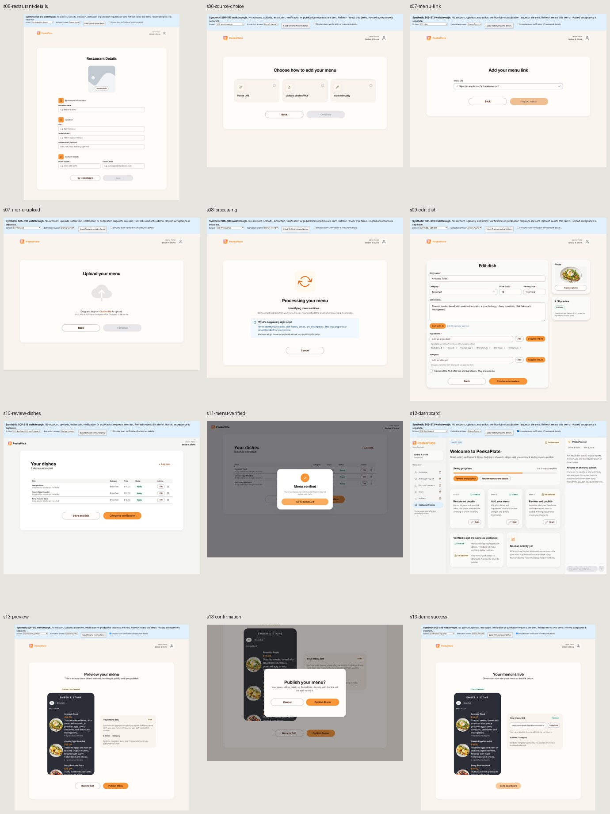

# Owner S05–S13 correction and review guide

Prepared by Sai · 2026-11-16. This is one integration correction using the team's
authored screens. The PR preview is a synthetic walkthrough, not a staging
deployment or evidence that paid extraction/AI acceptance has passed.

## Start the PR preview

Open `/owner-onboarding.html?journey` on this PR's console preview. No login is
needed. The blue controls explicitly simulate responses; they never submit an
upload, call a provider, verify a restaurant, publish a menu or send analytics.
Nothing survives refresh. The separate `/owner-dashboard.html` retains the
existing Menu-origin form and dashboard demo for comparison.

1. S05: enter restaurant details and Save → S06.
2. S06: choose link/upload → S07 → S08. The labelled extraction answer selects
   dishes/no dishes/failure. Manual entry opens the existing S09 form.
3. S09: edit the authored fields, photo and confirmations → Continue to review.
4. S10: review/edit/remove/Undo; Complete verification opens S11. This does not
   publish. Go to dashboard opens S12.
5. In the demo controls only, simulate the team's restaurant verification. S12
   then offers Review and publish. This checkbox is not a live owner permission.
6. S13: inspect the same demo dishes, confirm Publish Menu, inspect the labelled
   example link and return to S12. No real restaurant URL is created by the demo.

Jeffin: review the component provenance and the transitions. Vivien: review the
whole walkthrough and the remaining live gates below. Please distinguish the
blue synthetic control bar from product controls.

## Existing implementations reused

| Source | Reused code | Adaptation in this correction |
|---|---|---|
| [#171](https://github.com/vivienk/peekaplate/pull/171) | `RestaurantDetails`, `ChooseMenuSource`, `AddMenuLink`, `UploadMenu`, `MenuProcessing`, `OnboardingLayout` | S05 authenticated persistence; async photo/dirty protection; processing recovery action placed with Cancel. Screen markup/tokens retained. |
| [#172](https://github.com/vivienk/peekaplate/pull/172) | Authored `DishForm` and `DishFormFrame` | Extracted its existing presentation into `DishFormView`; both the original demo adapter and live draft adapter render it. Serving size, original currency and private photos round-trip. No second form implementation. |
| [#156](https://github.com/vivienk/peekaplate/pull/156) | Owner-menu transport, draft/candidate mappings, evidence | Extended the same authenticated client and save commands; no competing client. |
| [#163](https://github.com/vivienk/peekaplate/pull/163), [#206](https://github.com/vivienk/peekaplate/pull/206) | `ReviewDishes`, readiness rules and verification dialog | Connect persisted removal/Undo and extracted-photo corrections. Keep verification separate from approval/publication. |
| [#207](https://github.com/vivienk/peekaplate/pull/207), reviewed source `460c4462` | Processing/recovery changes | Adapted sequential job/draft reads, selected-import completion, explicit failed/empty states and guarded retry navigation. Did not merge the whole draft branch or overwrite #206's verification. |
| [#125](https://github.com/vivienk/peekaplate/pull/125), [#139](https://github.com/vivienk/peekaplate/pull/139) | `FirstDashboard`, `OwnerShell`, setup rules | Replaced hard-coded setup facts with the same server read shared by content/header/aside. Restore original layout wrappers. |
| [#208](https://github.com/vivienk/peekaplate/pull/208) | Official `MenuPreview`, phone view and confirmation/link states | Merged first as `a4d4889a`. Reuse its controller and screen; remove the temporary S13. Restore missing dish description. |

No design-token values are changed. The new preview controller contains local
navigation/state only. It does not implement another S05–S13 visual system.

## Backend consolidation on this same PR

The integration retains this PR as the single owner-flow correction. Source
increments from #210 at `40281acf`, #215 at `6bf4498f` and #209 at `7dba1a89`
are reconciled here; their presence does not constitute separate hosted releases.

- #215 now reuses this PR's profile contract, private-photo model and unchanged
  `20261116020000` migration. Its earlier duplicate profile projection is removed.
  Photo retries repair missing/corrupt objects only with the authenticated exact
  hash-bound bytes. The producer reads public name/logo through that same model.
- Preserve this PR's removal/Undo, corrected allergens/photo ownership checks and
  descriptive serving size while adding #215's separate numeric serving count.
  A numeric-looking serving label is not evidence of a people-served count.
  The existing S09 presentation has an additional optional People served field;
  its placement is a functional extension awaiting design review. No original
  field, form, token or style is replaced. Blank count remains unknown and does
  not qualify a dish for measured placement.
- #210 records pending ingredient labels in the existing draft-save transaction.
  Its read-only pending list also locks and rechecks current membership inside
  its transaction. Placeholders contain no image and confer no artwork approval.
  Existing #165/#178 generation/review/delivery remains the implementation.
- #209's exact report-period guard hides recommendations for another window.
  It does not provide trusted freshness, model credentials or S09 AI drafting.
- The combined correction schema derives its incomplete-field limit from the
  supported field enum, so all twelve fields can be marked incomplete without
  dropping serving-size/photo/allergen or serving-count information.

The approval-to-admission bridge reported by Teeyansh must be pinned to its
actual repository/commit before adding runtime adapters. Until that source and
its trusted runner are integrated, the existing producer/admission operator
boundary below still applies. This consolidation does not invent another bridge,
enable provider traffic or grant the API runtime privileged admission rights.

Consolidation verification (local; no hosted rollout): `pnpm check` passed 1,991
unit tests with five existing skips and all 117 script tests. `pnpm verify
test:db` passed 396 pgTAP assertions and 162 Worker/database tests (37.44s
integration phase), plus the disposable Worker smoke. The connected workspace
suite passed 53/53 Chromium cases in 1.2 minutes after the latest authored design
refinements, including the delayed-profile-save navigation regression, manual photo/text/count
save/reload, exact snapshot publication/retry, session/tenant isolation and the
report-period guard. Published branding/artwork/portion checks passed 5/5 in 16.9s;
they cover gating/fallback, not physical-device scale. `pnpm verify build` passed
both frontend builds and Worker dry-run. Production-like builds exclude the
synthetic demo controllers. These checks do not certify fresh provider extraction
or end-to-end hosted owner-report/AI acceptance.

The latest authored #213 design refinements are retained, including logo wording,
origin-specific Back navigation, heading focus, layout and S13 confirmation icon.
A delayed profile save now preserves navigation if the owner already left S05;
its browser regression failed before the two-line existing-generation guard and
passed afterward. No new screen or token system was introduced.

## Confirmed missing backend pieces added

- Profile read/save/setup endpoints reuse the existing staff/venue transaction
  and transport. Profile and private-photo metadata force tenant RLS. Browser
  fields cannot supply verification status or tenant authority. Changed details
  return to submitted; they do not become verified or published.
- The existing account control exposes Restaurant details in both dashboard and
  onboarding frames. Leaving unsaved work still requires confirmation. A private
  photo's delayed blob URL does not reset typing; a changed saved photo identity
  still resets the original form's baseline.
- Private profile-photo uploads are bounded and hash/idempotency bound. Reads
  reauthorize and verify the stored bytes. Blob URLs carry no token.
- Serving size is stored for manual drafts and candidate corrections. Owner
  allergen corrections/photo references survive extracted-dish reload and
  approval; unknown/proposed allergens do not become confirmed public facts.
- Candidate corrections lock linked drafts, reject removed work, advance the
  content version and invalidate earlier verification. Approved revisions remain
  immutable when a later candidate correction is saved.
- Draft removal is reversible metadata, not DELETE. Its own version/event stream
  preserves draft-save replay, source evidence, photos and exact Undo identity.
  Unchanged removal/Undo preserves content verification. Stale versions and
  accepted/published drafts cannot be overwritten by removal.
- Verification's final reread excludes removed drafts, matching the visible
  review list. The regression removes a dish, restores it, removes it again,
  then verifies only the remaining dish with a stable retry command.
- Cross-tab identity changes fence old session-expiration callbacks, so a late
  old-owner request cannot cancel the new owner's verified session.

Migration `20261116020000_owner_flow_profile.sql` is new and forward-only. It has
not been applied to hosted staging by the local checks. Existing applied
migrations are unchanged. Deploying the new console requires its matching API
and migration; the old staging API cannot satisfy the new profile/setup reads.

## Boundaries still requiring acceptance

- **New draft → prepared snapshot:** existing dish approval, Python T0 photo
  preparation, bundle production/upload and privileged admission remain the
  operator path documented in [owner-publish-handoff.md](owner-publish-handoff.md).
  #208 publishes an exact admitted snapshot. It does not automatically publish
  newer draft edits. No privileged runtime admission grant or second extraction
  pipeline is introduced here.
- **Team restaurant verification:** owners submit details. Only a trusted team
  operation can verify them. A successful form save is not verification. Profile
  event replay reconstructs saved submissions; it is not proof of a later
  privileged verification decision.
- **S09 AI buttons:** the authored controls stay visible, but live drafting is
  unavailable until a real authorized drafting service exists. Keyword/demo
  generators remain demo-only. Existing owner report AI is a different API.
- **Dashboard/AI:** publishing alone does not establish trustworthy reports,
  freshness, model credentials or completed Overview/Actions data adapters. No
  fictional dashboard metrics or AI answers are mounted in the live workspace.
- **Design decisions:** S10's ready footer retains #206's Complete verification;
  an incomplete menu retains Import more dishes / Save and Exit. S12 retains the
  authored Added and Start labels. Do not remove working verification to match
  one archived screenshot. Missing OCR currency gets a narrow correction field;
  existing recorded currencies are preserved.
- Queues/provider budgets and production/.io hosting are unchanged. The existing
  staging fictional venue was renamed Ember & Stone without changing its UUID,
  membership or persistent diner alias. Its old published bundle is immutable;
  a restaurant-name change in a new bundle requires a new prepared revision.

## Original screen walkthrough and historical verification

The 24 screenshots below use real rendered components with fictional local
state. Browser navigation passed at 1440px and 390px in 14.3s including startup.
They are not hosted acceptance or physical-phone/camera calibration.

| State | Desktop | Mobile |
|---|---|---|
| S05 details | [1440](review/owner-flow-screens/s05-restaurant-details-1440.png) | [390](review/owner-flow-screens/s05-restaurant-details-390.png) |
| S06 source | [1440](review/owner-flow-screens/s06-source-choice-1440.png) | [390](review/owner-flow-screens/s06-source-choice-390.png) |
| S07 link | [1440](review/owner-flow-screens/s07-menu-link-1440.png) | [390](review/owner-flow-screens/s07-menu-link-390.png) |
| S07 upload | [1440](review/owner-flow-screens/s07-menu-upload-1440.png) | [390](review/owner-flow-screens/s07-menu-upload-390.png) |
| S08 processing | [1440](review/owner-flow-screens/s08-processing-1440.png) | [390](review/owner-flow-screens/s08-processing-390.png) |
| S09 edit | [1440](review/owner-flow-screens/s09-edit-dish-1440.png) | [390](review/owner-flow-screens/s09-edit-dish-390.png) |
| S10 review | [1440](review/owner-flow-screens/s10-review-dishes-1440.png) | [390](review/owner-flow-screens/s10-review-dishes-390.png) |
| S11 verified | [1440](review/owner-flow-screens/s11-menu-verified-1440.png) | [390](review/owner-flow-screens/s11-menu-verified-390.png) |
| S12 dashboard | [1440](review/owner-flow-screens/s12-dashboard-1440.png) | [390](review/owner-flow-screens/s12-dashboard-390.png) |
| S13 preview | [1440](review/owner-flow-screens/s13-preview-1440.png) | [390](review/owner-flow-screens/s13-preview-390.png) |
| S13 confirm | [1440](review/owner-flow-screens/s13-confirmation-1440.png) | [390](review/owner-flow-screens/s13-confirmation-390.png) |
| S13 demo success | [1440](review/owner-flow-screens/s13-demo-success-1440.png) | [390](review/owner-flow-screens/s13-demo-success-390.png) |

Local database checks passed: 382 pgTAP assertions, 158 Worker/database integration
tests (36.89s for integration), plus the disposable local Worker command smoke.
The suite uses the restricted runtime role, not a privileged substitute.
Connected-workspace Chromium checks passed 50/50 in 54.4s, including persisted
save/reload, private photos, exact active-draft verification, denial and session
switches. The related authored onboarding/review/photo/preview suite passed 52/52
in 1.1 minutes. `pnpm check` passed 1,957 unit and 117 script tests; builds and
strict preview isolation checks passed. The hosted PR walkthrough was navigated
in Brave through S05, URL import simulation, edit/review, verification, dashboard
and official S13 confirmation/example-link state. That checks the hosted demo,
not real API/extraction/publication acceptance. Final commit/CI are on the PR.
