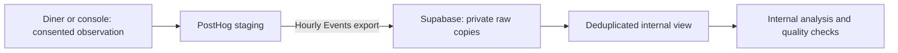
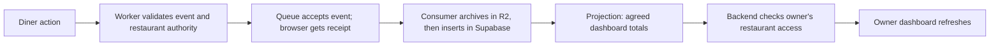

# PostHog to Supabase

## Status

**Verified October 21, 2026: staging export and repeated-interval checks passed; the hourly schedule is enabled.** Migration `20261020070000` is applied and recorded in Supabase. The dedicated `peekaplate_posthog_staging` login uses the existing restricted export group. The official Supabase CA and hostname verification are retained; grants were not broadened.

Destination `01a15822-9737-0001-7711-d5a784eb2635` exports Events hourly, including only `app_shell_viewed` with `environment = staging`. [Run history](https://us.posthog.com/project/675372/pipeline/batch-exports/01a15822-9737-0001-7711-d5a784eb2635?tab=runs) records these successful checks for October 20, 2026, 06:00–07:00 UTC:

| Check | Observed result |
| --- | --- |
| Initial successful run `01a15d4f-261f-0000-b88a-3f67d622bc39` | Completed; four exported rows; Supabase raw readback four rows and four event identities |
| Repeat run `01a15d53-eb5b-0000-0e3e-3ccb4c589db6` | Completed; Supabase raw count eight, deduplicated view count four |
| Known diner and console test records | Each matched once in the view by `distinct_id`, event, project, environment and surface |
| Out-of-scope rows, missing identities, conflicting identities | Zero in each check |
| Effective exporter permissions | Append allowed; update/delete/truncate, schema creation and application-schema access denied |
| Public and application-runtime access | `anon`, `authenticated` and `peekaplate_runtime` have no analytics-schema access |
| Schedule | Hourly enabled and saved after successful verification |

Earlier attempts failed certificate verification, then a missing database password, then password authentication. A privately generated replacement credential was set by the operator and verified through an independent PostgreSQL connection before the successful hosted exports. The original authentication mismatch/cache cause was not established. Inspect individual runs and database rows: an earlier backfill wrapper showed “Completed” while its underlying run failed.

These checks prove the bounded synthetic transfer and retry behavior. On October 22, the run history showed subsequent hourly runs completing successfully; the latest inspected run was `01a1672c-5761-0000-4453-2b83d1fc11dd`. Recent windows exported zero rows, so they establish successful scheduled execution, not new diner activity or completeness. A fresh read-only Supabase audit still found eight raw copies and four deduplicated events. Sustained monitoring, production traffic and account-specific spending limits have not been verified.

The diner and console staging sites already send optional shell-view observations to PostHog after consent. Real menu controls and the durable diner-evidence pipeline are separate tickets.

## What this adds

[ADR 0014](adr/0014-team-analytics-access.md) adds a narrow internal inspection API: current repository collaborators can request redacted events/counts through a checked database function using their own GitHub identity. The application runtime still has no direct analytics-schema access, and owners receive no access to these records. Migration and Worker deployment are complete; hosted positive reads passed. See [team access and remaining 403 checks](team-data-access.md).



Both kinds of data live in the same Supabase database:

| Location | Purpose | Access |
| --- | --- | --- |
| `app_private` | Authorized restaurant changes, staff membership, receipts and projections | Existing restricted backend role and RLS |
| `analytics_private.posthog_events` | Raw optional observations copied from PostHog | Dedicated exporter can read/append; database operator can inspect |
| `analytics_private.posthog_events_deduplicated` | Exact repeats counted once; conflicting/missing identities excluded | Database operator and restricted internal function owner; runtime receives only checked function execution under ADR 0014 |

Exporting a row does not make it a verified restaurant fact. There is no owner dashboard endpoint for these tables yet. Developers can use synthetic local fixtures; they do not need the export password.

## Why the owner dashboard must not wait for this export

The hourly copy serves internal analysis and reconciliation. It is **not the delivery path for a live owner dashboard**. An action just after an export window closes can wait almost another hour, plus processing time; failed runs can delay it further.

The accepted owner-report path is still planned:



For example, opening a dish produces an observation with a stable event ID and the exact published dish version. After validation and storage, its eligible view count can increase once, even if delivery retries. The dashboard reads that restaurant's updated count through its authorized API. This path does not wait for a PostHog batch.

The aim is prompt updates, with an explicit freshness target agreed and tested in the event/dashboard tickets. No seconds-level latency has been measured yet. Queue delays, processing failures and dashboard refresh frequency all affect what an owner sees. Show the last successful update and a delayed-data state rather than presenting stale totals as live. The event pipeline, projections and owner-query endpoint remain implementation work under [ADR 0003](adr/0003-intent-evidence.md).

## Connection setup

1. Apply [the forward migration](../migrations/20261020070000_posthog_exports.sql) through the reviewed migration process. Reuse the existing staging Supabase project; do not provision another database.
2. Create a dedicated `peekaplate_posthog_staging` LOGIN with `INHERIT`, membership in `peekaplate_posthog_export`, and no superuser, role creation, database creation, replication or RLS bypass. Set a unique password privately using SCRAM-SHA-256 encryption, and enter the same password in PostHog. Creating a LOGIN does not itself set a password. Check only that a password exists and that the role has not expired; never display its stored verifier. Do not reuse the application, `postgres` or service-role credential. Grant database `CONNECT` if not already inherited from PUBLIC.
3. Use the verified Supabase direct or **session-pooler** host/port and database `postgres`. Copy the provider's exact connection settings; the session pooler may require a project-qualified username. Do not guess the host or use Hyperdrive as the exporter destination.
4. In PostHog project `675372`, choose **Data management → Destinations → Postgres batch export**. Create a PostgreSQL connection with **Verify certificate authority and server hostname**. Use the trusted CA bundle or the provider certificate; do not turn verification off to solve a connection error.
5. Choose **Events**, hourly, schema `analytics_private`, table `posthog_events`, and property filter `environment = staging`. Initially include `app_shell_viewed` only. Add `dish_open` / `portion_compare` only when their real callers are implemented and reviewed.
6. Enable the schedule only after the restricted connection succeeds. Backfill only the bounded synthetic test interval required for verification. Record the destination ID, schedule and successful run time without storing credentials.

The precreated Events table needs only `SELECT, INSERT` and schema `USAGE`: the inspected exporter discovers the table before deciding whether to create it. If a provider update demands broader grants, investigate first. Do not grant general schema creation or application access as a shortcut.

For this connection, the first attempt with system certificate authorities failed. Download the root certificate linked in **Supabase → Database → Settings → SSL configuration**, attach it in PostHog, and retain **Verify certificate authority and server hostname**. Re-run the bounded interval and verify destination rows before resuming the hourly schedule. Do not disable TLS verification to clear the error.

Certificate recheck on October 21 UTC: the local `Supabase Root 2021 CA` expires April 26, 2031. A credential-free PostgreSQL TLS negotiation against `aws-0-us-east-2.pooler.supabase.com:5432`, using this CA with hostname verification, passed with TLS 1.3. No database authentication or SQL was attempted. The `2021` name does not indicate expiry; this check confirms the local CA works for the inspected host, not that a new PostHog form has saved it or that its password is correct.

An earlier independent credential check returned `28P01`. After the private credential correction, the same restricted session-pooler connection authenticated successfully with CA and hostname verification; both hosted export runs above then passed. Native DNS resolved the direct host to IPv6, but the direct connection returned `ENETUNREACH`, so direct authentication was not tested. No credential is stored in project files; the successful pooler route requires no new IPv4 add-on.

For password failures after a rotation, first confirm LOGIN, expiry and password format without displaying the stored verifier. [Supabase documents temporary pooler credential caching](https://supabase.com/docs/guides/troubleshooting/supavisor-error-password-authentication-failed-after-password-rotation). Avoid rapid repeated rotations or retry loops. Re-enter the exact database password privately in the existing PostHog connection, preserving the host, qualified username, CA and hostname verification. If failures persist, an authorized operator can test a direct connection privately to distinguish credential failure from pooler failure; escalate a pooler-only failure to Supabase. A temporary cache is a possible cause, not an established diagnosis for this incident.

## Verify the actual transfer

Generate one consented synthetic observation from each staging site. Record their generated IDs locally, wait for the export run, and match `distinct_id`, event name, surface and environment in Supabase. Verify the scheduled run's status in PostHog; an HTTP capture response alone is insufficient.

Run these queries as an authorized database operator:

```sql
-- Repeated identical copies must not inflate this internal count.
SELECT event, properties->>'surface' AS surface, count(*)
FROM analytics_private.posthog_events_deduplicated
WHERE properties->>'environment' = 'staging'
GROUP BY event, properties->>'surface';

-- Conflicting identity groups need investigation; the view excludes them.
SELECT team_id, uuid, count(*) AS raw_copies
FROM analytics_private.posthog_events
WHERE team_id IS NOT NULL AND uuid IS NOT NULL
GROUP BY team_id, uuid
HAVING count(DISTINCT to_jsonb(posthog_events)) > 1;

SELECT count(*) AS missing_identity_rows
FROM analytics_private.posthog_events
WHERE team_id IS NULL OR uuid IS NULL;
```

Repeat the same synthetic export interval. Raw copies may increase; the deduplicated count must stay unchanged. Test the export login cannot read `app_private.venues`, update/delete landing rows or create schema objects. Confirm `analytics_private` is absent from Supabase's exposed schemas. Never attach raw personal rows or credentials to a PR.

## Operation, cost and recovery

Hourly export means delayed availability, not a one-hour delivery guarantee. Use PostHog's run history for freshness and failures; client event timestamps are not a reliable import-progress cursor. Assign an operator to check failed/overdue runs and retry bounded intervals. The deduplicated view prevents exact retry inflation but does not prove complete delivery.

[PostHog pricing](https://posthog.com/pricing) currently lists one million batch-export rows per month free. This is separate from product-analytics event allowances. Repeated exports/backfills can consume additional rows. The account's actual plan and limits must be verified by its administrator; Supabase storage/compute limits still apply. No paid upgrade is included in this setup.

To stop copying, pause the destination and disable the dedicated LOGIN after checking no run is active. Keep records for investigation; use a reviewed forward change for schema corrections. Before real diner data, approve retention and implement deletion across PostHog, Supabase copies and backups. The existing short-retention proposal is not an automatic deletion job.

Design decision: [ADR 0013](adr/0013-posthog-export-boundary.md). Existing capture behavior: [PostHog setup](posthog.md).
