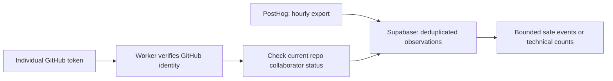

# Team access to staging analytics

## Current availability

October 22 update: the [operations record](operations.md) documents main-only staging restrictions, required reviewers and prevent self-review, with administrator bypass allowed. It also records migration `20261021130000` as absent in the hosted audit and GitHub-held token permissions as unverified. Complete those release checks before enabling deployment.

**Prepared and tested locally; not yet live.** On October 21, the hosted Worker health check returned 200, but the new analytics endpoint returned 404. The Worker had no configured secrets, GitHub listed no deployment environments or repository Actions secrets, and the operator account had write access without admin permission. Do not distribute the endpoint as ready until the activation checklist below passes.

The access rule includes **every accepted repository collaborator**, not a named group. New collaborators qualify automatically; pending invitations must be accepted first. Nobody needs a Supabase database account for this API. PostHog dashboard access is a separate invitation and is not granted by this API.

## What teammates receive

All current collaborators of `vivienk/peekaplate` are eligible, including new collaborators added later. Authenticate with your own GitHub user token; the Worker asks GitHub to verify the token's identity and checks collaborator status on every request. Public repository visibility, a username or a Supabase account alone never grants access. Removed collaborators fail the next membership check. Provider errors/rate limits fail closed. There is no cached member list and no three/four-person allowlist.

No database login, export password, service-role key or shared team API password is distributed. Internal GitHub authentication is separate from the existing Supabase staff/restaurant login, which remains unchanged.

These endpoints inspect optional staging observations. Counts describe captured events, not unique diners, menu sessions, orders or owner business metrics. They cannot authorize a restaurant or supply live owner reporting. Do not expose this diagnostic API to restaurant owners. The owner report work remains [S3-DATA-02 / the metric dictionary](implementation_plan.md#6-dashboard-metric-dictionary).

## API contract

Both endpoints require `Authorization: Bearer <your own GitHub user token>`:

| Endpoint | Result |
| --- | --- |
| `GET /team/analytics/events?from=2026-10-20T06:00:00Z&until=2026-10-20T07:00:00Z&limit=50` | Latest safe, deduplicated event records; default 50, maximum 100; `truncated=true` means the window contains more records. Narrow the time range to inspect them. |
| `GET /team/analytics/summary?from=2026-10-20T06:00:00Z&until=2026-10-20T07:00:00Z` | Event counts grouped by event name and diner/console surface, using the same eligible records. |

Use UTC `Z` timestamps with a positive range of at most seven days. The range includes `from` and excludes `until`. Duplicate or unknown query parameters are rejected. The server selects the PostHog project; callers cannot choose a GitHub username, actor, role, project or SQL. Responses are `no-store` and identify the source as `posthog_supabase_export`, the environment as `staging`, and freshness as `hourly_export_delay`. `computedAt` is query time, not the last successful import time. A zero count does not prove collection was complete.

An event contains `id`, `event`, `timestamp`, `surface` and an allowlisted `properties` object. Supported properties are `schema_version`, `event_id`, `publication_hash`, `dish_revision_hash`, `displayed_tier`, `manifest_hash` and `availability_version`, when valid and present. No `distinct_id`, person fields, IP, URL or arbitrary properties are returned. Currently hosted capture/export includes only `app_shell_viewed`; `dish_open` and `portion_compare` require real UI callers and an intentional export-filter update.

Errors: 401 means missing/invalid GitHub user token; 403 means not a current repository collaborator; 400 means invalid query; 503 means configuration, database or response-validation failure. The endpoints return 404 outside explicitly configured local/staging Workers. This API has no data-write or grant-administration endpoint, no arbitrary SQL and no permissive browser CORS. Use a local API client; a future browser inspector must have reviewed origin controls.

## How a teammate uses it

1. Accept the repository collaborator invitation. PostHog membership remains a separate invitation if you need its event browser; this API does not administer PostHog or grant database dashboard access.
2. Use a personal, expiring GitHub user token in your local API client's Bearer authorization field. A fine-grained token with public-repository read/metadata access is sufficient for the caller identity lookup; no code-write or administration scope is required. Do not use the shared deployment/checker token or a GitHub Actions bot token. GitHub CLI users may use their own existing authenticated credential locally, but must never print or attach it to tickets, chat or shared collections. Revoke it if exposed.
3. Call the two GET endpoints with the required UTC window. Keep authorization in your API client's private/local secret storage. No separate Supabase account or database password is needed for this internal tool.
4. Test capture in PostHog first; Supabase will reflect it only after a successful hourly export. Check the [export run history and recovery notes](posthog-export.md).

Base URL after the reviewed release is deployed: `https://peekaplate-api-staging.vxkong.workers.dev`. A PR/local test does not activate a hosted endpoint. There is no browser sign-in screen in this slice; use a local API client. A future UI must use a reviewed OAuth flow and origin controls rather than embedding privileged tokens.

## Operator: scope and revocation

Apply migration `20261021130000` before the reviewed Worker deployment. The private `team_api_private.project_scope` row enables only staging PostHog project `675372`. No teammate list is copied into the public repository or manually maintained in Supabase. The Worker obtains the caller's login from GitHub's authenticated `/user` response, then calls the fixed repository's collaborator-check endpoint using the private server token. Client-supplied usernames or editable profile fields are never authority.

To withdraw a person's eligibility, remove repository collaboration; the next uncached check denies access. A request already authorized may finish. To disable inspection for everyone, the database operator can delete the staging project-scope row, or remove the Worker server token. Keep Hyperdrive query caching disabled so scope changes are not served from query cache. No API endpoint can modify this scope.

The application runtime receives only `USAGE` on `team_api_private` and `EXECUTE` on one fixed read function. It still cannot select raw analytics or change project scope. The function is owned by a non-login role with only required reads and a fixed `pg_catalog` search path. Its database boundary limits the project/environment and returned fields; the Worker owns GitHub identity/collaborator authorization. The export and restaurant-command privileges remain separate. Never expose `team_api_private` or `analytics_private` through Supabase's Data API. This is project-wide internal diagnostic access, not restaurant membership. Do not use it with real diner data until access/retention policies are approved.

## GitHub and provider configuration

GitHub Secrets supplies CI/deployment jobs; it is not a vault teammates retrieve passwords from. An admin must create **Settings → Environments → staging**, limit deployments to `main`, and configure available approval controls before enabling deployment. Put scoped `CLOUDFLARE_API_TOKEN` and `TEAM_GITHUB_TOKEN` values there as **environment secrets**, and `CLOUDFLARE_ACCOUNT_ID` as an **environment variable**. The checker token must belong to an account with push access, be limited to `vivienk/peekaplate` and have only repository **Metadata: read** for the collaborator check. Its expiry/rotation is an operator responsibility. Store the same checker token as a Cloudflare Worker secret named `TEAM_GITHUB_TOKEN`; it is never returned by the API. No Supabase admin, export password or PostHog personal API key is needed by this feature or by routine CI. The workflow writes the checker secret into a private temporary file and passes it through Wrangler’s additive deploy secrets-file option, then removes the file.

Worker configuration uses the existing restricted Hyperdrive binding and Supabase Auth issuer, plus `APP_ENV=staging` and `POSTHOG_PROJECT_ID=675372`. Database credentials stay inside Hyperdrive. The ordinary test suite uses disposable local credentials, signing keys and a local GitHub API fixture; it needs no hosted secrets. `LOCAL_GITHUB_API_URL` is accepted only in local mode and only for HTTP loopback test servers. Staging always calls the fixed GitHub API origin.

Share the API URL and PostHog project link as non-secret setup configuration. This inspection API needs no Supabase browser key. Never distribute a Supabase service-role or secret key as frontend configuration. Contributors can develop locally with synthetic fixtures before receiving any hosted access.

On October 21, the authenticated GitHub account had repository write access but no admin permission; no GitHub environments or repository Actions secrets were listed. Environment activation and the Cloudflare deployment token are operator steps, not completed by this source change. No paid plan or new Cloudflare resource is required by this design; actual existing quotas still apply.

## Repository owner: activate and hand over

1. Open [repository environment settings](https://github.com/vivienk/peekaplate/settings/environments) and create `staging`. Restrict deployment branches to `main` and require an independent deployment reviewer using the controls available for the repository. Keep `STAGING_DEPLOYMENT_APPROVED` off until these controls are configured.
2. Inside the `staging` environment, add secrets `CLOUDFLARE_API_TOKEN` and `TEAM_GITHUB_TOKEN`. The Cloudflare token must be scoped to the existing PeekaPlate account and Worker deployment permissions. The **repository owner** should create the expiring GitHub checker token for resource owner `vivienk`, selected repository `peekaplate`, repository permission **Metadata: read**, and no code-write/admin permission. Do not paste either value into a PR, issue, chat or tracked file.
3. In the same environment, set variable `CLOUDFLARE_ACCOUNT_ID` to the existing staging account ID from [backend/wrangler.jsonc](../backend/wrangler.jsonc). Only after migration status and its history record, token permissions, release review/CI and deployment controls are verified, set repository variable `STAGING_DEPLOYMENT_APPROVED=true`. These variables are configuration, not passwords.
4. Apply forward migration `20261021130000` to the existing staging Supabase database using [the database change procedure](operations.md#database-change-procedure), including migration-history recording. The Worker uses its existing Hyperdrive connection; no new database, database login or export credential is required. If using the SQL editor, execute only the migration's `migrate:up` section; the intentionally unsupported `migrate:down` section raises an error and must not be included.
5. Review the final PR commit and its CI, then merge to `develop`. Promote the reviewed release to `main` under ADR 0012. Merging this feature PR alone does not deploy it. From [Actions](https://github.com/vivienk/peekaplate/actions), run **Deploy staging Worker** on that exact `main` commit. The workflow injects the checker secret into the Worker; contributors never receive it.
6. Run the hosted acceptance checks below and record the deployed SHA/version and results in the PR. Confirm `events` and `summary` return 200 for a current collaborator, no/invalid token returns 401, a valid non-collaborator token returns 403, and removing a controlled test collaborator denies its next request. Verify redacted responses and the existing staff/export behavior. Never remove a real teammate merely to test this.
7. Announce access only after these checks pass. Send collaborators the API URL and this guide. Each person uses their **own** GitHub token in a private local API client. They receive no database password, checker token or deployment secret. PostHog event-browser membership is granted separately when their work requires it.

If activation is delayed, collaborators can continue with the repository's local synthetic fixtures. An empty result after deployment can mean the selected window has no exported observations; check the hourly PostHog export before treating it as a tracking defect.

## Release acceptance

- Apply the forward migration before deploying the Worker; preserve the existing exporter and restaurant permissions.
- Deploy only the reviewed release under [ADR 0012](adr/0012-main-environment-promotion.md); confirm Hyperdrive query caching is disabled.
- Use an approved collaborator’s individual GitHub token to verify 200 and bounded redacted results, a non-collaborator’s valid token to verify 403, and no/invalid token to verify 401. Verify removal denies the next check using a controlled test account.
- Confirm production returns 404, PostHog export continues, and raw tables remain inaccessible to public/application roles.
- Record the deployed SHA and evidence. All accepted repo collaborators are eligible after activation; the migration grants no public or database-console access.

Decision: [ADR 0014](adr/0014-team-analytics-access.md). This does not change the owner-metric suppression threshold or implement S3-DATA-02.

Provider references: [GitHub collaborator check](https://docs.github.com/en/rest/collaborators/collaborators#check-if-a-user-is-a-repository-collaborator), [GitHub environment secrets](https://docs.github.com/en/actions/how-tos/write-workflows/choose-what-workflows-do/use-secrets).
