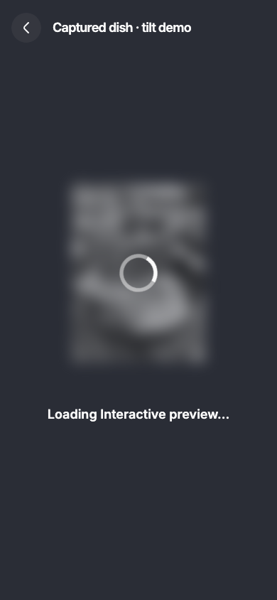
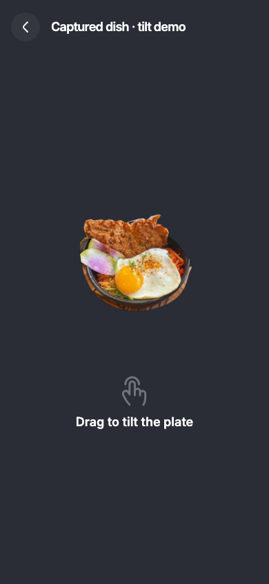
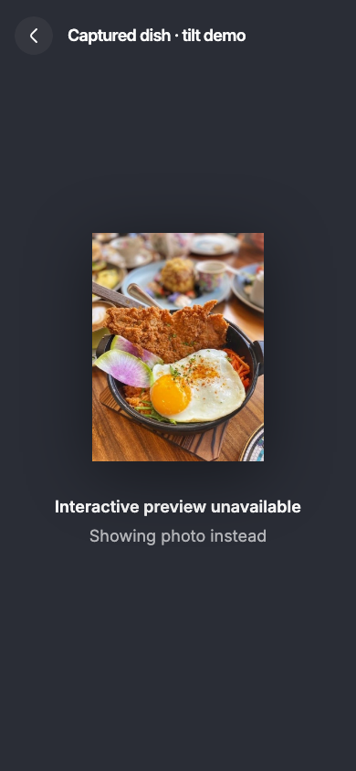
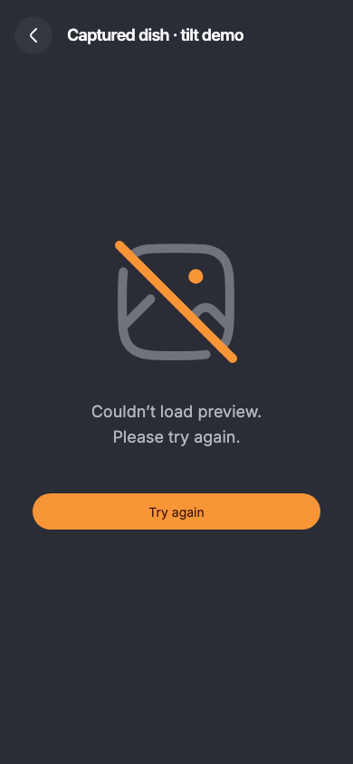

# Diner portion preview evidence

Local development review on Node 24.16.0 / pnpm 11.25.0, Chromium at 390 × 844.
Screenshots exercise the generated PR25 photo/mask fixture through the actual preview UI.

| Loading | Ready |
| --- | --- |
|  |  |
| Photo fallback | Failed |
|  |  |

## Verification

- PASS: focused Python processing tests — 34 tests (actual T0, review, spatial and new diner export).
- PASS: `pnpm verify lint typecheck context:check docs:check`.
- PASS: `pnpm verify test build` — 1,214 Vitest tests passed, 4 skipped; all 74 script tests passed. All app builds passed; Worker build was dry-run only.
- PASS: `pnpm exec playwright test --config playwright.portion.config.ts --workers=2` — all 45 browser tests passed on the processor-integrated code.
- PASS: `pnpm exec playwright test --config playwright.portion.config.ts tests/e2e/portion.spec.ts --grep 'Figma|local captured' --workers=2` — all 5 passed again after the backdrop-color correction; screenshots above are from this final run.
- PASS: `PYTHONPATH=processing/src:processing/tests python -m unittest processing/tests/test_diner_demo.py processing/tests/test_review_preview.py processing/tests/test_assets.py processing/tests/test_spatial.py` — 34 passed, rerun after the backdrop correction (existing focused Python environment with Pillow/Pydantic).
- PASS: inspected production output: no demo host, review identity, demo module or photo assets.
- PASS: `git diff --check`.
- Initial JS: 52,657 gzip bytes / 150,000 limit. T1 budget: 372,771 / 400,000 bytes including 48,116 font bytes and the 200,000-byte layer/manifest allowance.
- NOT RUN: full default browser suite, database suite (no database changes), physical phone performance, manual VoiceOver/TalkBack, hosted approved-asset publication.

The final suite supersedes earlier setup failures recorded in errors.md: restricted
local listeners, a missing report link, widened JSON literal typing and a browser
run disrupted while source files were changing. The stable browser run passed.

## Scope and remaining limits

PR25's existing `prepare_review_preview` now actually generates the demo. Its T0
photo validation, supplied mask, cutout and unchanged fallback feed the diner through
`diner_demo.py`; generated `demo.json` retains processor identity and needs_review /
publication-ineligible provenance. This is not optional generated-candidate support
or an approved production publication pipeline. Demo menu facts are placeholders.

Automated architecture/correctness reviews of the processor integration found no
blocking issues. The create-only CLI can leave a partial output directory on a disk
write failure; rerun into a new destination after addressing the disk error.

Figma frames: loading 846:7146, ready 258:6000, photo fallback 221:260, failed 165:2413
in file l7A9n8tACJic0FIhY49Zjw. Exact exported artwork is included. The web preview uses
safe-area insets instead of a simulated native status bar.

No merge or deployment. Local evidence is not hosted publication acceptance.
