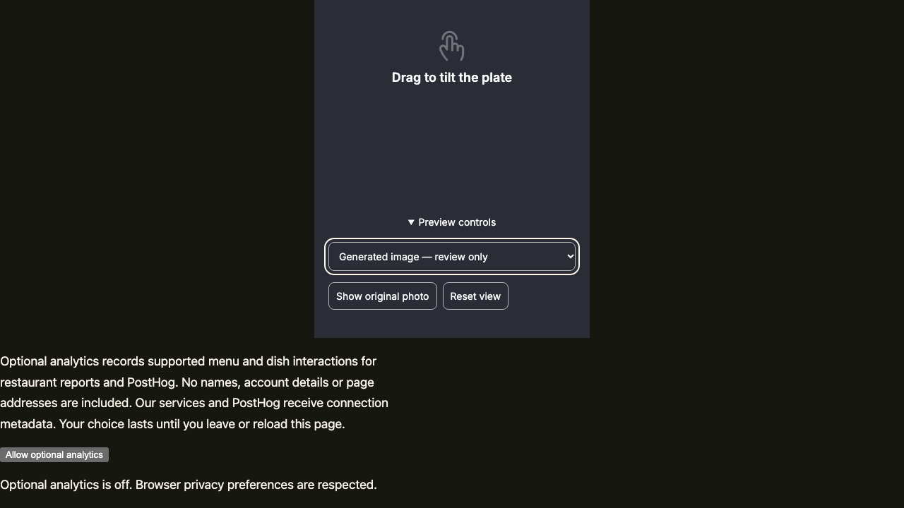
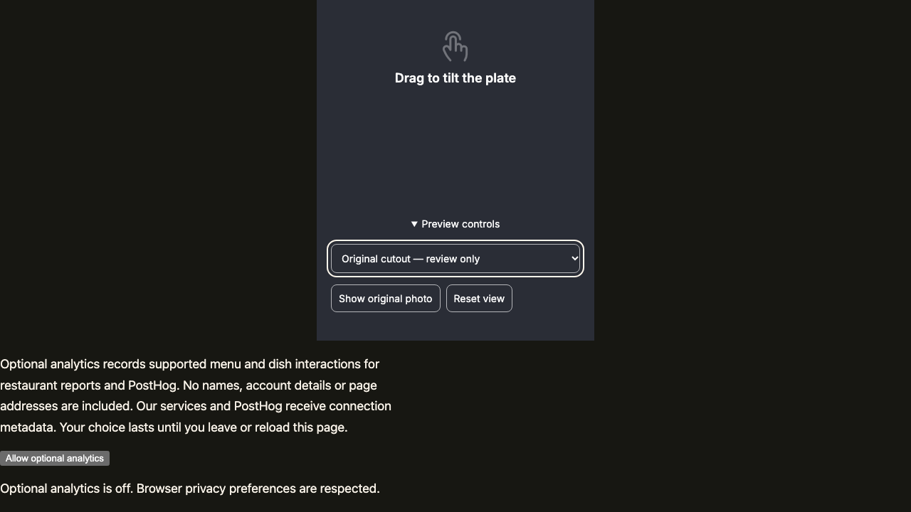

# Figma screens with PR25 viewer — November 12, 2026

Local development evidence on Node24.16.0 / pnpm11.25.0. The latest user direction
selects the supplied Figma screen composition while preserving the accepted PR25 image bytes and movement within View Portion. Four state categories and Back/retry navigation are preserved.

| Ready | Loading |
| --- | --- |
|  |  |
| Original-photo fallback | Failed / retry |
|  |  |

## Exact original image correction

The earlier demo re-encoded the cutout and omitted the generated presentation.
The local selector now uses the exact prior PNGs, with byte hashes checked in the browser.
Generated presentation is the default; Original cutout is selectable above the stage.
Both remain needs-review and publication-ineligible, excluded from production builds.

| Generated presentation | Original cutout |
| --- | --- |
|  |  |

Latest correction checks: PASS `pnpm exec playwright test --config playwright.portion.config.ts --workers=2`
(52/52); PASS `pnpm verify lint typecheck build`; PASS exact-asset and selector exclusion
from production dist. The broader unit/script results below predate this asset correction.

## Implemented behavior

- Dark390px Figma shell, Inter type, centered250px dish and native42px Back,64px spinner,46px gesture hint and150px unavailable illustration. Compare/reset and DEV image selection sit in an expandable Preview controls disclosure below the main composition.
- CSS900px perspective, up to±3° rotation,5px/3px translation. Pointer replaces the
  shared position; keys step1/6. Pointer tracking55ms linear, reset/keys300ms ease-out.
- Show original photo / Show review candidate, aria-pressed, Reset view, Home,
  horizontal touch tilt, vertical scrolling and live reduced-motion support.
- No WebGL/Three.js dependency. The spatial backdrop is validated but visually replaced
  by the dark screen surface; foreground cutout layers move together.
- Original photo must decode before interaction. Missing/invalid cutouts retain the photo;
  missing photo shows failed/retry. Back/Escape/browser history preserve detail state/focus.
- PR25 processing output identity/provenance remains needs_review and publication-ineligible
  in the DEV fixture. No production approval/hosting path was added.

## Current Figma verification

- PASS: `pnpm exec playwright test --config playwright.portion.config.ts --workers=2` —52/52.
- PASS: `pnpm verify lint typecheck build` and `pnpm verify context:check docs:check`.
- PASS: `node --test scripts/check-bundle.test.mjs` —6/6, including all three font weights.
- Initial JS53,046 gzip bytes; T1 delivery273,769/400,000 bytes including72,472 font bytes.
- Architecture and correctness reviews resolved the font-budget finding at3db33af.
- NOT RUN: physical phones, manual screen readers, hosted publication and full database suite.

Figma loading frame was read through design context. The connector then reached its
plan limit; ready and unavailable frames were inspected in the browser. Existing exact
SVG exports are reused at native sizes. Ready/loading/unavailable renders were visually
inspected. Native device status bars are handled by the browser safe area rather than
fake clock/battery UI. Supplementary controls are below the Figma composition.

## Earlier verification (before Figma shell correction)

- PASS: `pnpm exec playwright test --config playwright.portion.config.ts --workers=2` —52/52 in the latest clean run. Includes compare/reset, exact motion/timing, original-photo failure, integrity, reduced motion, cancellation, navigation and four screenshots.
- PASS: `pnpm verify lint typecheck test build` —1,214 Vitest tests passed,4 skipped;74 script tests passed; app builds and Worker dry-run passed.
- PASS: final `pnpm verify lint typecheck build context:check docs:check` after layout corrections.
- PASS: `git diff --check`; production JS excludes DEV fixture host and WebGL renderer.
- Initial JS53,014 gzip bytes /150,000 limit. T1 delivery201,297 /400,000 bytes including200,000-byte asset/manifest allowance.
- Inspected all four390×844 screenshots. Read-only architecture/correctness review found no blocking issues on implementation7909e9c.
- NOT RUN: full default browser suite, database suite(no database changes), physical phones,
  manual VoiceOver/TalkBack, hosted approved-asset publication. Python processing unchanged
  in this correction; prior34-test processing evidence remains historical, not rerun here.

Earlier setup/test observations and corrections are recorded in errors.md. The new
appearance/control regression failed against the previous viewer before implementation.

## Local viewing

Open `http://127.0.0.1:5173/?scenario=portion-demo`, select the dish, then View Portion.
`previewState=loading` delays loading; `previewState=photo` forces original-photo fallback;
`previewState=failed` forces failure/retry. Legacy `previewState=fallback` still opens the
interactive cutout. The four categories originate from Figma846:7146,258:6000,221:260,
165:2413; the latest request restores the Figma layout while retaining PR25 image and movement.

Local branch only. No PR, merge, workflow setting change or deployment.
